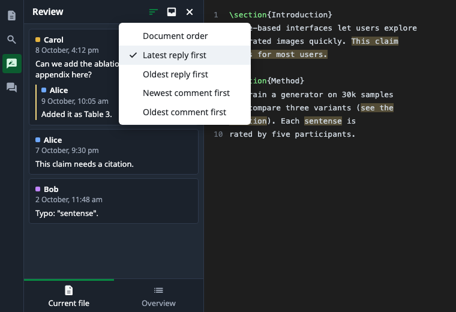
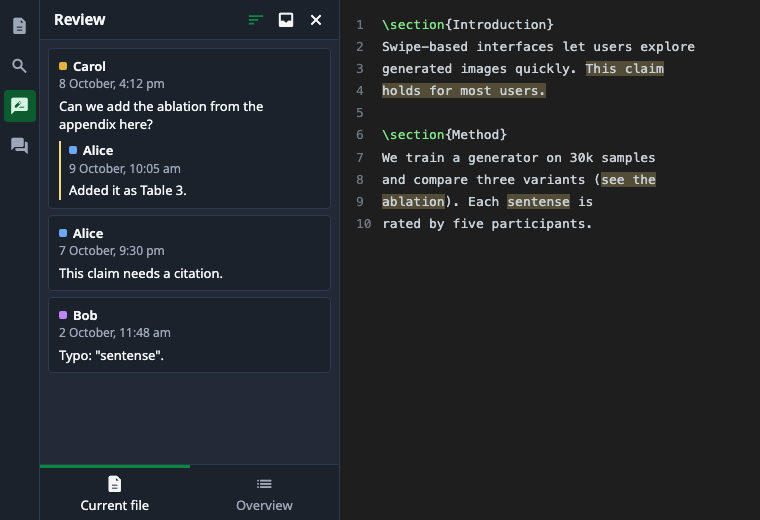
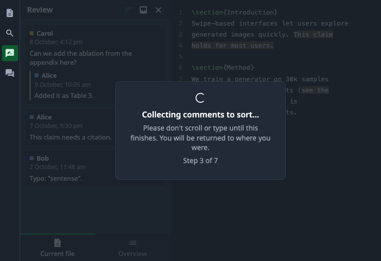

# Overleaf Comment Filter

[日本語](README.ja.md)

A Tampermonkey userscript that sorts the comments in Overleaf's review panel
by time. It works on overleaf.com and reorders Overleaf's own comments in both
tabs of the panel, so replying and resolving keep working as usual.



The images in this README are illustrations with sample data.

## What it does

A sort button sits in the review panel header, next to the Resolved comments
button. It offers five orders:

- Document order (Overleaf's own layout; the default)
- Latest reply first
- Oldest reply first
- Newest comment first
- Oldest comment first

The chosen order applies to both tabs of the panel:

- **Current file**: the comments, normally placed next to their lines, become
  one list in the chosen order, pinned to the top of the panel.
- **Overview**: the comments of each file are sorted within that file.



Overleaf only draws the Current file comments near the part of the document
you have scrolled to. To list all of them, the script scrolls through the
document once, then returns you to where you were. While it does, an overlay
covers the editor and holds clicks and key presses, so nothing is typed into
the document.



The sort button turns green while a time order is active. It dims while
comments are loading and turns red if sorting fails; the menu then shows the
reason.

## Install

1. Install [Tampermonkey](https://www.tampermonkey.net/) in Chrome.
2. Allow Tampermonkey to run userscripts:
   - Chrome 138 or later: open `chrome://extensions`, open Tampermonkey's
     **Details**, and turn on **Allow User Scripts**.
   - Older Chrome: turn on **Developer mode** at the top right of
     `chrome://extensions`.
3. Open
   [overleaf-comment-filter.user.js](https://raw.githubusercontent.com/mei28/overleaf-comment-filter/main/dist/overleaf-comment-filter.user.js)
   and click **Install** on the page Tampermonkey shows.
4. Reload any Overleaf tab that was already open.

### Updates

Tampermonkey checks for new versions and updates the script by itself. To
update right away, open the Tampermonkey menu and choose **Check for
userscript updates**.

## Use

1. Open a project on overleaf.com.
2. Open the review panel from the icon bar on the left.
3. Click the sort button (left of the inbox icon) and choose an order.
4. Choose **Document order** to return to Overleaf's own layout.

When you open another file while a time order is active, the script scrolls
through that file in the same way.

## Limitations

- Only overleaf.com's current editor is supported.
- The script relies on parts of Overleaf that are not a public API: the
  `window.overleaf.unstable.store` object Overleaf exposes for extensions,
  React's internal data on the comment elements, and the class names of the
  review panel. An Overleaf update can break sorting. When that happens, the
  script shows the reason in the menu and leaves Overleaf's own layout in
  place.
- The Current file scan needs the tab to be in the foreground. It takes about
  0.2 seconds per screen of text.
- In the Overview tab, Overleaf does not draw the comments of collapsed files.
  They are sorted once the file is expanded.
- Tracked changes stay after the comments, in Overleaf's order.
- "Last reply" means the newest message in a thread; edits to a message do
  not count.

## Privacy

The script runs in your browser only. It reads `GET /project/{id}/threads`
(the request Overleaf's own review panel makes) with your existing session
and sends nothing anywhere else. It never writes to your project.

## Development

Requires Node.js 24, pnpm and [just](https://github.com/casey/just).

```sh
just install      # install dependencies
just test         # run the tests
just check        # lint, type-check, test and build; must pass before a commit
just watch        # rebuild .dev-dist/ on every change
just dist         # build the release files into dist/
just screenshots  # render docs/images/ from docs/screenshots/mock.html
```

### Trying changes in the browser

overleaf.com's Content Security Policy blocks scripts loaded from a local dev
server, so the Vite dev server is not used. Load the watched build from disk
instead:

1. Run `just watch`.
2. In `chrome://extensions`, open Tampermonkey's **Details** and turn on
   **Allow access to file URLs**.
3. Disable the installed script, then add this loader script in Tampermonkey,
   with the path changed to your checkout:

   ```js
   // ==UserScript==
   // @name         Overleaf Comment Filter (dev)
   // @namespace    https://github.com/mei28/overleaf-comment-filter
   // @version      0.0.0
   // @match        https://www.overleaf.com/project/*
   // @grant        none
   // @run-at       document-idle
   // @noframes
   // @require      file:///path/to/overleaf-comment-filter/.dev-dist/overleaf-comment-filter.user.js
   // ==/UserScript==
   ```

4. Reload the Overleaf tab after each rebuild. If Tampermonkey keeps an old
   copy, set **Settings → Externals → Update Interval** to **Always**
   (Settings mode **Advanced**).

### When Overleaf changes

Every assumption about Overleaf's page lives in `src/overleaf/`. Errors name
the selector, store value or field that no longer matches.

- For a changed API response, update the synthetic fixtures in
  `test/fixtures/`, run `just test`, watch the decoder tests fail, then fix
  the decoder in `src/api/`. Never commit real responses: they contain
  collaborators' names, emails and comments.
- For a changed page, update `src/overleaf/selectors.ts` or the other files
  in `src/overleaf/`, and the tests that mirror Overleaf's markup.

### Release

1. Bump `version` in `package.json`. Tampermonkey only updates when the
   version increases.
2. Run `just check` and `just dist`.
3. Commit `dist/` and push to `main`.

## License

MIT
